<div align="center">

# CFD: Circular Cylinder

**Verification** of CFD Predictions for Flow Around a Circular Cylinder Using OpenFOAM


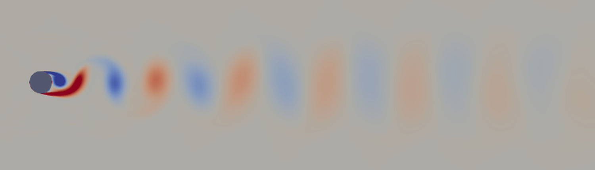

<sub>Vorticity behind the cylinder, medium mesh. Red turns counter-clockwise, blue clockwise.</sub>

[Key finding](#key-finding) · [Results](#results-at-a-glance) · [Gallery](#gallery) · [How it works](#how-it-works) · [Report](report/report.md) · [Slides](report/presentation.pdf) · [Setup](#setup)

</div>

## Key finding

> [!NOTE]
> On three systematically refined meshes and three time steps, the 2-D URANS k-ω SST model predicts **St = 0.251 ± 0.004** and **mean C<sub>D</sub> = 1.000 ± 0.004** for the cylinder at Re = 66,667, with every mesh and time-step difference below 2 %. The numerical error is small and known. Validation against experiments is not part of this project (see [Validation](#validation)).

## Results at a glance

| Quantity | Simulation | Numerical uncertainty |
|---|---|---|
| St | **0.2512** | ± 0.0041 (1.6 %) |
| mean C<sub>D</sub> | **1.000** | ± 0.004 (0.4 %) |
| rms C<sub>L</sub> | **0.766** | ± 0.023 (3.0 %) |
| base C<sub>p</sub> | **-1.299** | ± 0.017 (1.3 %) |

<sub>Fine mesh (38,418 cells), Δt = 5e-5 s, statistics over t = 0.5 to 1.5 s. U<sub>num</sub> combines the mesh study (GCI or half the spread) and the time-step study.</sub>

| Check | Required | Result |
|---|---|---|
| tests | all pass | ✅ 30 passed, 1 skipped (no validation reference data) |
| checkMesh | "Mesh OK" on every mesh | ✅ |
| shedding periods per run | at least 15 | ✅ 23 or more |
| C<sub>D</sub>, first half vs second half | below 1 % | ✅ at most 0.10 % |
| mesh and time-step differences | below 2 % | ✅ at most 1.6 % (mesh) and 1.0 % (time step) |

## Gallery

<table>
  <tr>
    <td width="50%">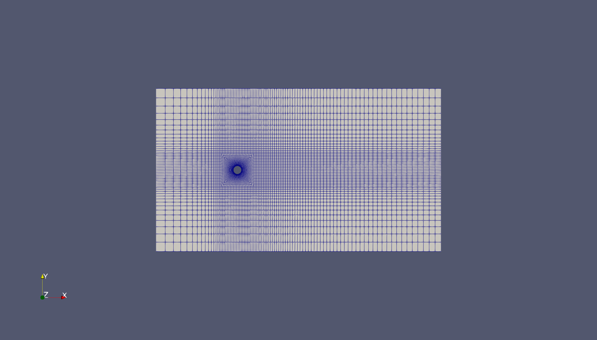<br><sub><b>Mesh.</b> The O-grid near the cylinder, coarse level.</sub></td>
    <td width="50%">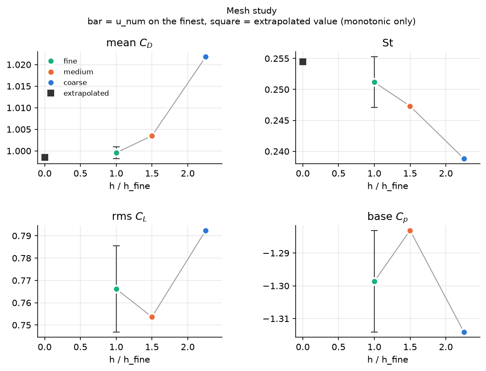<br><sub><b>Mesh study.</b> Mean drag and St converge steadily toward the extrapolated value; rms lift and base pressure oscillate, within 3 %.</sub></td>
  </tr>
  <tr>
    <td>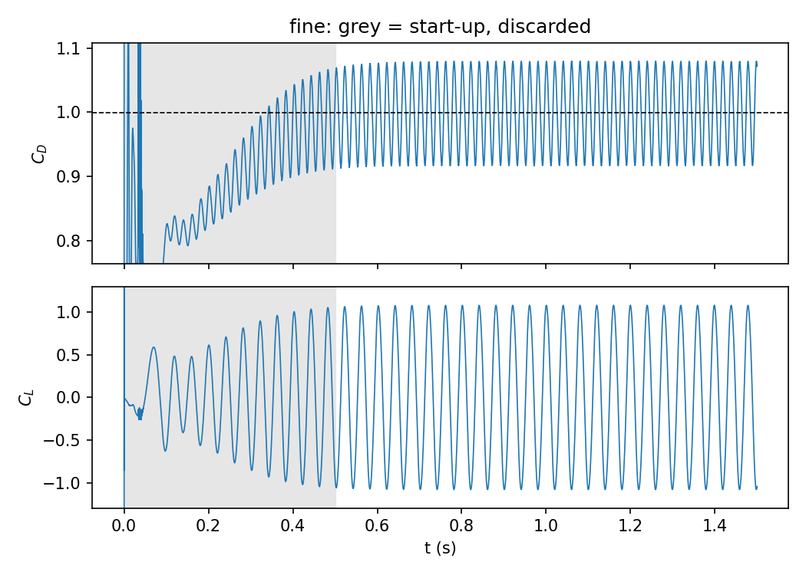<br><sub><b>Forces.</b> Drag and lift on the fine mesh: the start-up (grey) is discarded, then the shedding is regular.</sub></td>
    <td>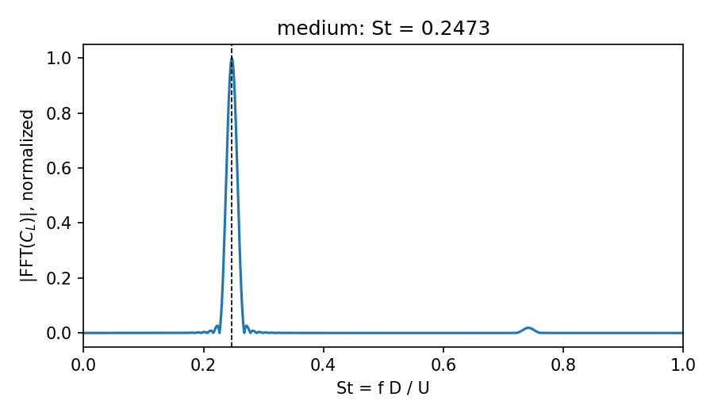<br><sub><b>Shedding frequency.</b> The peak of the lift spectrum gives St.</sub></td>
  </tr>
  <tr>
    <td>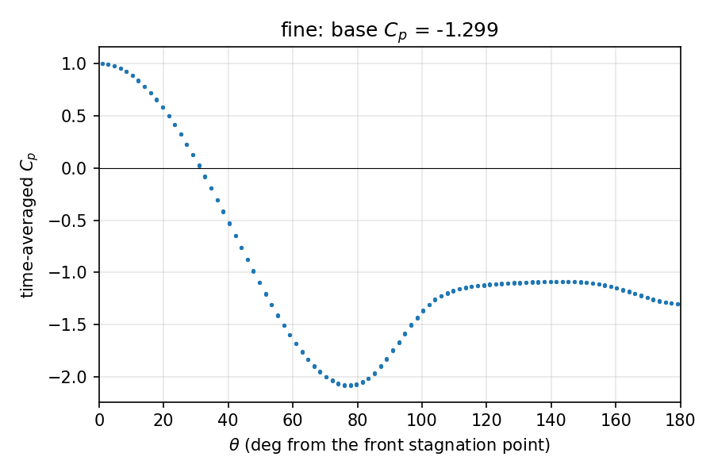<br><sub><b>Pressure.</b> The mean pressure coefficient around the cylinder, fine mesh.</sub></td>
    <td>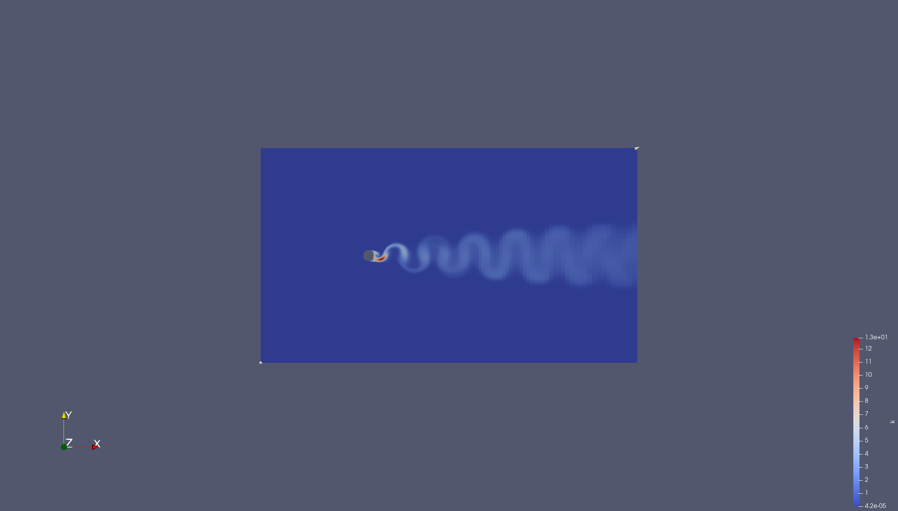<br><sub><b>Turbulence.</b> Turbulent kinetic energy, made in the shear layers and carried down the wake.</sub></td>
  </tr>
</table>

## How it works

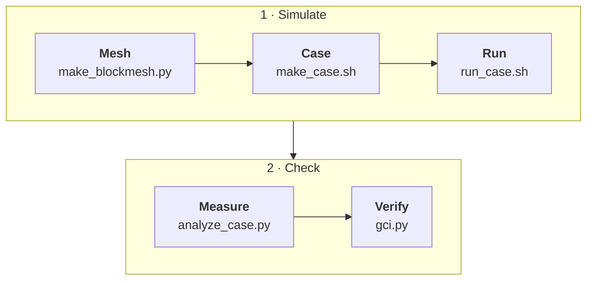

| Stage | What it does | Checked by |
|---|---|---|
| Mesh | the O-grid at three refinement levels | pytest, checkMesh |
| Case | copies the case template, adds the mesh | checkMesh: "Mesh OK" |
| Run | pimpleFoam, URANS k-ω SST | Courant number, y+ |
| Measure | C<sub>D</sub>, C<sub>L</sub>, St, and C<sub>p</sub> over whole shedding periods | pytest, 15 periods, halves within 1 % |
| Verify | mesh and time-step studies, the grid convergence index | differences below 2 % |

This project covers verification: are the equations solved correctly? Validation, whether they are the right equations, needs a comparison with experiments and is not part of it; the tool for it is prepared (see [Validation](#validation)).

## Contents

[Objective](#objective) · [Problem](#problem) · [Method](#method) · [Domain](#domain) · [Mesh](#mesh) · [Baseline run](#baseline-run) · [Forces and shedding](#forces-and-shedding) · [Pressure](#pressure) · [Mesh study](#mesh-study) · [Time-step study](#time-step-study) · [Validation](#validation) · [Discussion](#discussion) · [Future work](#future-work) · [Tools](#tools) · [Setup](#setup) · [Repository layout](#repository-layout) · [References](#references) · [Environment](#environment) · [Agent log](#agent-log) · [Progress](#progress)

## Objective

This project investigates the accuracy and numerical sensitivity of CFD predictions for flow around a circular cylinder. It simulates the unsteady flow with OpenFOAM, shows mesh and time-step independence, and quantifies the numerical error. Comparing the results with published experiments (validation) is outside its scope.

## Problem

A uniform stream of air flows past a stationary circular cylinder. The cylinder is long, so the flow is modelled in 2-D.

| Symbol | Meaning | Value |
|---|---|---|
| D | cylinder diameter | 0.1 m |
| U | free-stream speed | 10 m/s |
| rho | air density | 1.225 kg/m^3 |
| nu | kinematic viscosity | 1.5e-5 m^2/s |
| Re = UD/nu | Reynolds number | 66,667 |

At this Reynolds number the boundary layer is still laminar when it separates (subcritical regime), the wake is turbulent, and vortices shed at a nearly constant Strouhal number. The drag crisis starts only at Re of about 2e5 to 5e5.

Quantities predicted:

| Quantity | Definition |
|---|---|
| mean drag coefficient | $C_D = F_D / (\tfrac12 \rho U^2 D\,s)$, time-averaged over whole shedding periods |
| rms lift coefficient | $C_{L,rms}$ of $C_L = F_L / (\tfrac12 \rho U^2 D\,s)$ |
| Strouhal number | $St = f D / U$, f from the FFT of $C_L(t)$ |
| pressure coefficient | $C_p(\theta) = (p - p_\infty) / (\tfrac12 \rho U^2)$, time-averaged |

s = 0.01 m is the depth of the 2-D slice; the coefficients do not depend on it.

Time scales: one flow-through of the domain takes 0.35 s, one shedding period about 0.05 s. Each run covers 1.5 s; the first 0.5 s is discarded as start-up, which leaves about 20 periods for statistics.

## Method

- **Equations:** incompressible Navier-Stokes (Mach 0.03), Reynolds-averaged in time (URANS). The vortex shedding is resolved in time; small-scale turbulence is modelled with an eddy viscosity.
- **Turbulence model:** k-omega SST (Menter 1994). It limits the eddy viscosity in adverse pressure gradients, which is where the flow separates.
- **Solver:** OpenFOAM `pimpleFoam` (transient, PIMPLE pressure-velocity coupling).
- **Forces:** pressure and viscous stress integrated over the cylinder every time step (`forceCoeffs`).
- **Verification:** three systematically refined meshes with the grid convergence index (Celik et al. 2008), three time steps, statistical convergence checks.
- **Validation:** not performed. `validation/compare.py` is prepared to compare C_D, St, rms C_L and base C_p with published experiments.

Assumptions and their expected effect:

| Assumption | Expected effect |
|---|---|
| 2-D flow | real wake is 3-D; 2-D models usually over-predict mean drag and lift fluctuation |
| URANS k-omega SST | treats the laminar separating boundary layer as turbulent; may shift separation and damp shedding |
| incompressible, constant properties | negligible at Mach 0.03 |
| inflow turbulence about 1 % | real experiments may differ; shifts separation at this Re |
| free-slip side walls, 5 % blockage, no blockage correction | slightly higher speed around the cylinder |
| smooth, stationary cylinder | no roughness or vibration effects |
| small initial cross-flow (0.3 m/s) to trigger shedding | removed by discarding the first 0.5 s |

## Domain

Cylinder centre at the origin, flow in +x.

    y = +1.0  +----------------------------------------------------+  top (symmetryPlane)
              |                +---------+                         |
    inlet     |                |  _---_  |                         |  outlet
    x = -1.0  |                | (  O  ) |   ->  wake  ->  ->      |  x = +2.5
    (U fixed) |                |  -___-  |                         |  (p fixed)
              |                +---------+                         |
    y = -1.0  +----------------------------------------------------+  bottom (symmetryPlane)

| Dimension | Value | In diameters |
|---|---|---|
| cylinder diameter D | 0.1 m | 1 |
| inlet distance from centre | 1.0 m | 10 |
| outlet distance from centre | 2.5 m | 25 |
| domain half height | 1.0 m | 10 |
| depth (one cell, 2-D) | 0.01 m | 0.1 |
| blockage D / height | 5 % | |

| Patch | Type | Location |
|---|---|---|
| inlet | patch | x = -1.0 m |
| outlet | patch | x = +2.5 m |
| top, bottom | symmetryPlane | y = +/-1.0 m |
| cylinder | wall | r = 0.05 m |
| frontAndBack | empty | z = +/-0.005 m (makes the case 2-D) |

Reference values for the force coefficients: U = 10 m/s, rho = 1.225 kg/m^3, lRef = D = 0.1 m, Aref = D x depth = 0.001 m^2.

The mesh is a structured O-grid of 16 blocks: 4 ring blocks around the cylinder (r = 0.05 to 0.075 m, boundary layer), 4 transition blocks to a 0.4 m square box, and 8 outer blocks stretched to the far field. The cells are nearly orthogonal to the wall, small near the cylinder and in the wake, and large far away.

## Mesh

Generated by `mesh/make_blockmesh.py`; refinement ratio 1.5 in each direction, every block's expansion kept, so the three meshes are geometrically similar.

| Mesh | Cells | Cells around the cylinder | First cell at the wall (m) | Max aspect ratio | Max non-orthogonality (deg) | Max skewness |
|---|---|---|---|---|---|---|
| coarse | 7,578 | 84 | 7.37e-5 | 50.9 | 41.9 | 0.50 |
| medium | 17,092 | 128 | 4.98e-5 | 22.3 | 43.0 | 0.52 |
| fine | 38,418 | 192 | 3.38e-5 | 27.0 | 43.7 | 0.53 |

All three pass `checkMesh` ("Mesh OK"). The total volume equals the domain minus the cylinder to 6 or 7 digits.

<table>
  <tr>
    <th width="50%">coarse</th>
    <th width="50%">fine</th>
  </tr>
  <tr>
    <td></td>
    <td>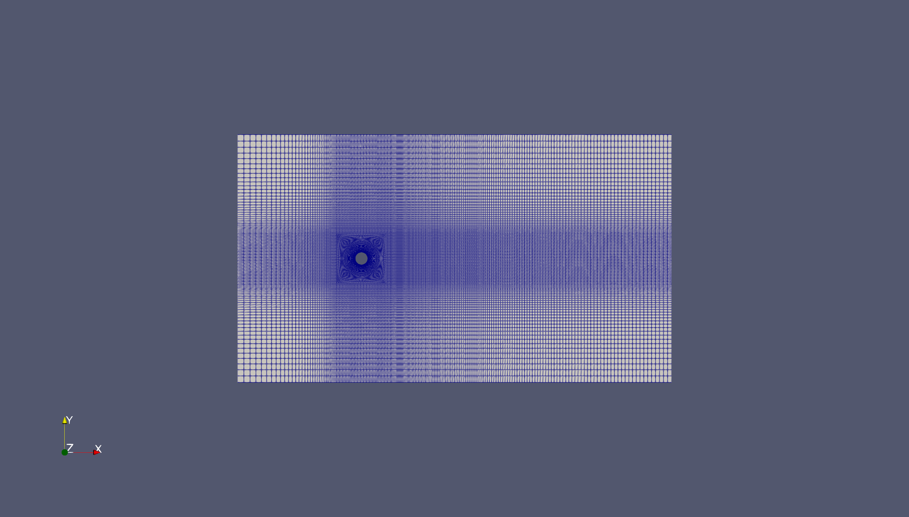</td>
  </tr>
</table>

The same view of the coarsest and finest mesh near the cylinder: the fine mesh has 2.25 times as many cells in each direction (two refinements of 1.5); the medium mesh lies in between.

## Baseline run

Medium mesh (17,092 cells), Δt = 5e-5 s, 1.5 s of flow (30,000 time steps), on 8 cores in 15.5 min.

| Check | Value | Healthy when |
|---|---|---|
| solver finished | log ends with `End` | |
| `nan` in the log; `bounding` after the start-up | 0; 0 (2 events at t < 0.001 s) | 0 |
| final pressure solve | 38 iterations on average, 70 at most | converges every step |
| max Courant number, t > 0.5 s | 0.75 | below about 1 |
| y+ on the cylinder (mean, max) | 1.0, 1.8 | about 1 or below |
| SST constants | as Menter (1994) | |

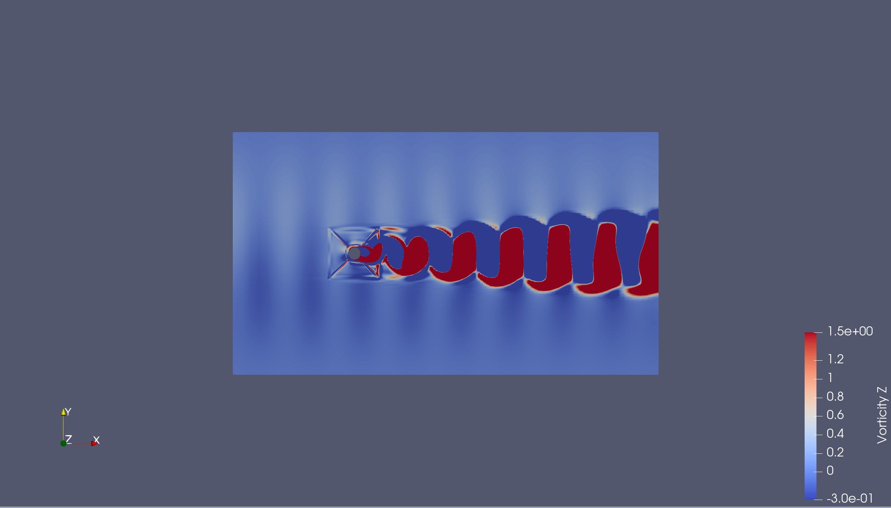

The wake sheds vortices alternately from the top and bottom of the cylinder: a von Kármán vortex street.


Turbulence is produced in the two shear layers that separate from the cylinder (red, k up to about 13 m^2/s^2) and carried downstream in the wake, where it decays. The free stream carries almost none.

## Forces and shedding

`postprocessing/analyze_case.py`: statistics over whole shedding periods after t = 0.5 s; St from the peak of the Hann-windowed spectrum of C_L, refined between FFT bins and checked against the zero-crossing frequency. Tested against signals with exact answers (`tests/test_analysis.py`).

| Run | Periods | St | mean C_D | rms C_L | C_D halves differ |
|---|---|---|---|---|---|
| medium | 24 | 0.2473 | 1.003 | 0.754 | 0.04 % |

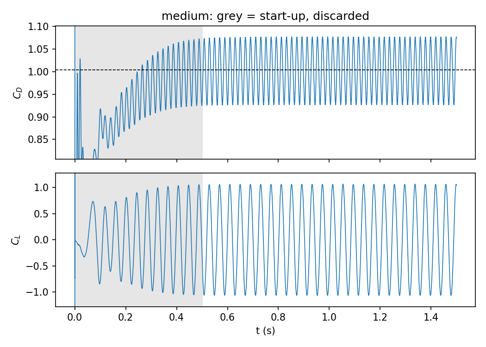

## Pressure

Time-averaged C_p on the cylinder from `pMean` (t > 0.5 s), with p_inf the mean pressure on the inlet patch (`postprocessing/pressure.py`, tested against potential flow). C_p = 1.00 at the front stagnation point confirms the reference pressure.

| Run | C_p minimum (angle) | base C_p (180 deg) |
|---|---|---|
| medium | -2.05 (77 deg) | -1.28 |

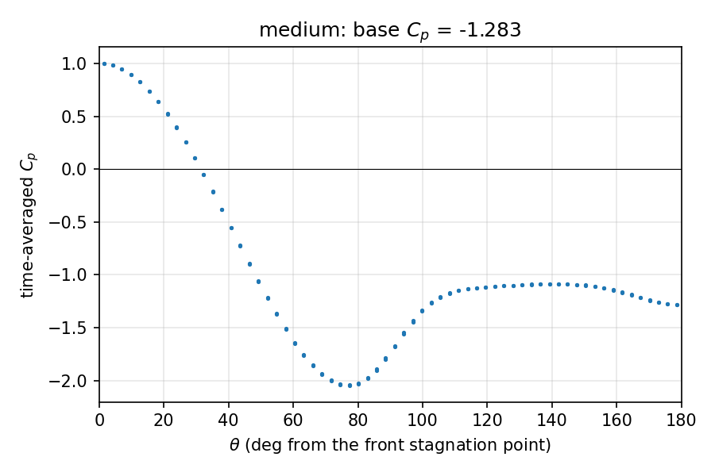

The flow separates before the top of the cylinder; the nearly constant low pressure behind it is the main source of drag.

## Mesh study

Same case and time step (Δt = 5e-5 s) on three meshes, refinement ratio 1.5 in each direction, statistics over t = 0.5 to 1.5 s.

| Mesh | Cells | St | mean C_D | rms C_L | base C_p | max Co (t > 0.5 s) | mean y+ |
|---|---|---|---|---|---|---|---|
| coarse | 7,578 | 0.2388 | 1.022 | 0.792 | -1.314 | 0.47 | 1.45 |
| medium | 17,092 | 0.2473 | 1.003 | 0.754 | -1.283 | 0.75 | 1.00 |
| fine | 38,418 | 0.2512 | 1.000 | 0.766 | -1.299 | 1.16 | 0.69 |

The coarse run clips slightly negative k (down to about -0.002 m^2/s^2) in 144 of its 20,000 measured steps; medium and fine never do.


A fourth, extra-fine mesh (86,956 cells) was not usable: at Δt = 5e-5 s it is unstable (Co of about 1.6 with one PISO pass), and at Δt = 2.5e-5 s its forces carry bursts of high-frequency noise from shear-layer vortices that the URANS model leaves undamped (nut / nu of about 2 at separation). The study therefore uses three meshes.

Grid convergence index after Celik et al. (2008), `verification/gci.py`; h = (A / N)^(1/2), r21 = 1.499, r32 = 1.502.

| Quantity | Convergence | Observed order p | Extrapolated | e_a21 (fine vs medium) | GCI_fine | u_num used |
|---|---|---|---|---|---|---|
| St | monotonic | 1.92 | 0.2545 | 1.54 % | 1.63 % | 1.63 % (GCI) |
| mean C_D | monotonic | 3.78 | 0.9985 | 0.39 % | 0.14 % | 0.14 % (GCI; p far above 2, so quote e_a21 = 0.39 % as the conservative figure) |
| rms C_L | oscillatory | - | - | 1.64 % | - | 2.5 % (half the spread) |
| base C_p | oscillatory | - | - | 1.20 % | - | 1.2 % (half the spread) |

All fine-medium differences are below 2 % (largest 1.64 %), as `CLAUDE.md` requires. The coarse mesh is outside the asymptotic range for C_D (p = 3.8) and clips negative k in a few steps; St converges at close to the formal second order (p = 1.9).

## Time-step study

Medium mesh at Δt = 1e-4, 5e-5, and 2.5e-5 s (ratio 2), statistics over t = 0.5 to 1.5 s, GCI with h = Δt (`verification/gci.py time`).

| Quantity | 1e-4 s | 5e-5 s | 2.5e-5 s | Observed order | Extrapolated | 5e-5 s off by |
|---|---|---|---|---|---|---|
| mean C_D | 1.0190 | 1.0035 | 1.0008 | 2.5 | 1.0003 | 0.32 % |
| rms C_L | 0.7843 | 0.7536 | 0.7464 | 2.1 | 0.7441 | 1.27 % |
| base C_p | -1.3263 | -1.2831 | -1.2778 | 3.0 | -1.2771 | 0.47 % |
| St | 0.2474 | 0.2473 | 0.2479 | oscillatory | - | below 0.3 % |

Max Courant number after the start-up: about 1.5, 0.75, and 0.38 (it scales with Δt). The step of 1e-4 s runs (just below the stability limit of about 1.6 found in the mesh study) but misses rms C_L by 5 %: stable is not accurate. The step used for the mesh study, 5e-5 s, is within 2 % for every quantity. For mean C_D its time error (0.32 %) is as large as the mesh difference (0.39 %), so U_num adds both.

## Validation

**Not performed.** This project stops at verification: it shows that the equations are solved accurately, not that they describe real air. The comparison needs experimental values, which go into `validation/reference_data.csv` only from sources I have read, each with its location in the source; `tests/test_validation.py` rejects a row without a source. No such values have been added, so no comparison is reported.

The tool is prepared for a later version. `validation/compare.py` compares the fine-mesh result S with an experimental value D for C_D, St, rms C_L, and base C_p:

- comparison error E = S - D;
- numerical uncertainty U_num = sqrt(u_mesh^2 + u_time^2), from the mesh study (GCI or half the spread) and the time-step study (1.25 times the distance of the 5e-5 s result from the extrapolated value, a project choice);
- validation uncertainty U_val = sqrt(U_num^2 + U_D^2), a simplified form of ASME V&V 20 that leaves out the input uncertainty U_input (not estimated in this project).

If |E| is within U_val, no model error can be shown at this level of uncertainty; if |E| is larger, the difference is model error.

Once reference data are added:

    python3 validation/compare.py --run fine

## Discussion

**Numerical uncertainty.** Combining the mesh and time-step studies, the fine-mesh results carry a numerical uncertainty of 1.6 % for St, 0.4 % for mean C_D, 3.0 % for rms C_L, and 1.3 % for base C_p. Every difference between the two finest meshes and between the two smallest time steps is below 2 %, so the numerical error is small and known. rms C_L is the least certain: it converges oscillatorily with refinement.

**What the verification does not cover.** The model errors are not bounded by these studies, because they are the same on every mesh: the 2-D simplification (2-D URANS tends to over-predict mean drag and rms lift, because the shed vortices are perfectly coherent along the span), the turbulence model treating the laminar separating boundary layer as turbulent, the decay of the inflow turbulence before it reaches the cylinder, and 5 % blockage without correction. Only a comparison with experiments can show how large they are and which dominates.

## Future work

In order of value, most useful first:

1. **Validation.** Add experimental values for C_D, St, rms C_L and base C_p at a similar Reynolds number to `validation/reference_data.csv`, from sources I have read, and run `validation/compare.py`. Estimate the input uncertainty U_input (inflow turbulence, fluid properties) as well. This measures the model error that the verification cannot.
2. **A real structure.** Apply the forces to an actual pole, chimney or cable:
   - choose one with known height, diameter, material, wall thickness and base fixing;
   - find its natural frequency from a structural-dynamics reference or a modal analysis;
   - compare it with the shedding frequency f = St U / D over the range of wind speeds it will see, to find the wind speeds where the two match;
   - check the result against the vortex-shedding method of a design code (for example EN 1991-1-4, Annex E).
3. **A moving cylinder.** This project holds the cylinder fixed, so it cannot show vibration amplitude or lock-in, where the shedding follows the structure's motion over a band of wind speeds. That needs fluid-structure interaction: a cylinder on springs and dampers, with a moving mesh in OpenFOAM or a coupled structural solver.
4. **Model fidelity.** The model errors listed in the Discussion, each tested on its own:
   - a 3-D domain several diameters long in the span direction, so the shed vortices can lose coherence;
   - scale-resolving simulation (DES or LES) instead of URANS;
   - other turbulence models, including a transition-sensitive one, since the separating boundary layer is laminar at this Re;
   - a larger domain or a blockage correction.
5. **Wider conditions.** Several wind speeds (a Reynolds-number sweep within the subcritical regime), different inflow turbulence levels, and surface roughness.
6. **Reducing the vibration.** Once validated, compare designs that disrupt the shedding, such as helical strakes; these need the 3-D model.

## Tools

- OpenFOAM
- ParaView
- Python: NumPy, SciPy, Matplotlib, pandas
- pytest
- ffmpeg (videos)
- Git and GitHub
- Claude Code (AI agent, rules in CLAUDE.md)

## Setup

Requires OpenFOAM (ESI release, tested with v2606) and ParaView:

    curl https://dl.openfoam.com/add-debian-repo.sh | sudo bash
    sudo apt-get update
    sudo apt-get install -y openfoam-default paraview
    echo "source /usr/lib/openfoam/openfoam2606/etc/bashrc" >> ~/.bashrc

Run this one-time if the repo does not exist in your directory yet:
```bash
git clone git@github.com:adibatic/cfd-cylinder.git
cd cfd-cylinder
python3 -m venv .venv
source .venv/bin/activate
pip install -r requirements.txt
```

Run this command every new terminal:
```bash
source .venv/bin/activate
```

## Repository layout

    mesh/             make_blockmesh.py: the O-grid at three refinement levels
    case/             OpenFOAM case template (0/, constant/, system/)
    scripts/          foam_env.sh, make_case.sh, run_case.sh
    postprocessing/   C_D, C_L, St, C_p, figures, and the animation
    verification/     grid convergence index
    validation/       the comparison with experiments (prepared, not run)
    tests/            pytest checks against exact answers (run: pytest)
    results/          figures, tables, and animations (all committed)
    report/           final report; presentation.pdf, a 10-slide talk for non-specialists
    runs/, media/     OpenFOAM runs and videos (generated, not tracked)

## References

- Celik, I. B., Ghia, U., Roache, P. J., Freitas, C. J., Coleman, H., & Raad, P. E. (2008). Procedure for estimation and reporting of uncertainty due to discretization in CFD applications. Journal of Fluids Engineering, 130(7), 078001.
- Menter, F. R. (1994). Two-equation eddy-viscosity turbulence models for engineering applications. AIAA Journal, 32(8), 1598-1605.

## Environment

<details>
<summary>Show</summary>

| Item | Value |
|---|---|
| OS | Ubuntu 22.04.5 LTS |
| CPU | AMD Ryzen 7 6800HS Creator Edition |
| Cores | 16 |
| RAM | 27Gi |
| OpenFOAM | ESI v2606 |
| ParaView | 5.10.0-RC1 |
| Python | 3.10.12 |
| NumPy | 2.2.6 |
| SciPy | 1.15.3 |
| Matplotlib | 3.10.9 |
| pandas | 2.3.3 |
| pytest | 9.1.1 |
| ffmpeg | 4.4.2-0ubuntu0.22.04.1 |

</details>

## Agent log

<details>
<summary>Show</summary>

| Date | What the agent did wrong | How I caught it | Rule added to CLAUDE.md |
|---|---|---|---|

</details>

## Progress

<details>
<summary>Show</summary>

Self-paced. Target: the whole project in about two weeks.

- [x] Milestone 1: Foundation. OpenFOAM and ParaView work, the repository is reproducible, the project rules are set.
- [x] Milestone 2: Problem defined. Physics, method, and domain are written down; pytest runs.
- [x] Milestone 3: Mesh. Three systematically refined meshes pass their tests and checkMesh.
- [x] Milestone 4: First flow. The baseline case runs and sheds vortices.
- [x] Milestone 5: Measurement. C_D, C_L, St, and C_p come from tested code with convergence checks.
- [x] Milestone 6: Verification. Mesh and time-step studies give the numerical uncertainty.
- [ ] Milestone 7: Validation. Not part of this version; the comparison tool is prepared (see [Future work](#future-work)).
- [ ] Milestone 8: Package the result. Figures, animation, report, and v1.0 release.

</details>
